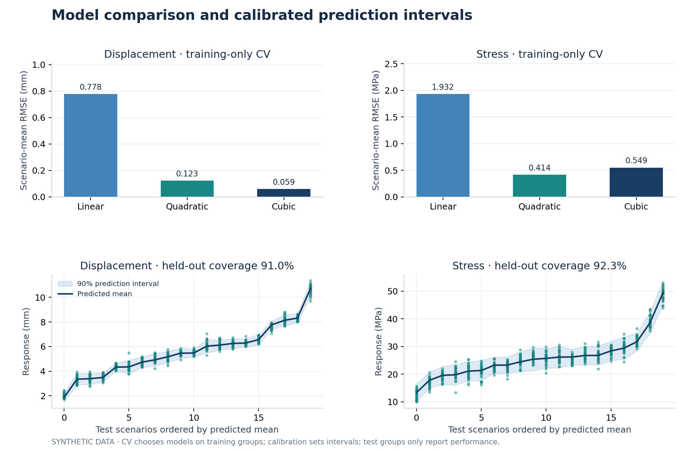
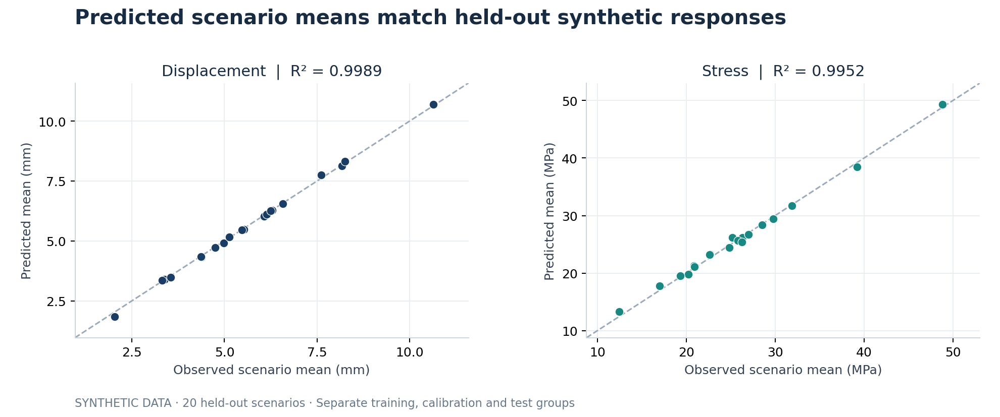
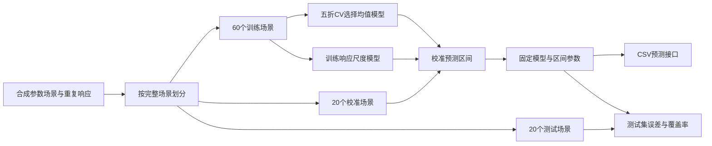

# 工程响应预测与不确定性分析

**Engineering Response Surrogate Demo**

输入刚度、荷载和几何参数，预测示例位移与应力，并给出 90% / 95% 预测区间。项目展示工程计算结果进入数据分析流程后，如何划分数据、比较模型、验证误差并提供可复用的预测入口。

本仓库是舒家浩求职作品集的 **合成数据演示版**，采用 Python / NumPy 实现，使用 AI 辅助整理。数据由明确的代数关系和随机噪声生成；示例结果不代表真实有限元、试验或汽车零部件性能。



## 可以看到什么

- **按场景划分数据**：100 个参数场景，每场景 30 次重复，共 3,000 条合成记录；训练 / 校准 / 测试为 60 / 20 / 20 个完整场景。
- **比较模型而非只报一个分数**：训练场景内五折交叉验证，比较线性、二次和三次多项式 Ridge 代理，分别选择位移与应力的模型。
- **预测值与区间一起输出**：用训练数据估计响应尺度，再用独立校准场景修正区间宽度。
- **保留验证证据**：导出分区、CV 结果、测试指标、逐条预测及可读 JSON 模型。
- **可直接使用的接口**：读取 CSV 输入，输出预测结果；缺失字段、非数值、空输入及超出适用域时报告错误。

## 快速运行

Python 3.11 或以上。在仓库根目录执行以下命令。建议使用独立环境；激活环境后，Windows、macOS 和 Linux 的运行命令相同。

```bash
python -m pip install -r requirements.txt
python -m unittest discover -s tests -v
python -m engineering_surrogate.run
```

完整演示默认输出至 `artifacts/`，包括数据、模型、结果和两张 PNG / SVG 图。默认随机种子为 `20261011`。重跑只会重新生成本演示的合成样本和小型代理模型，不调用有限元求解器。

只需运行模型而不生成图时，可仅安装 NumPy：

```bash
python -m pip install "numpy>=1.26,<3"
python -m engineering_surrogate.run --no-plots --output artifacts_local
```

仓库已附 `artifacts/model.json` 和示例 CSV，因此也可直接使用现成模型预测：

```bash
python -m engineering_surrogate.predict --model artifacts/model.json --input examples/prediction_inputs.csv --output artifacts_local/predictions.csv
```

## 输入与输出

| 输入字段 | 含义 | 演示适用域 |
| --- | --- | --- |
| `stiffness_factor` | 刚度倍率 | 0.8–1.2 |
| `load_factor` | 荷载倍率 | 0.5–1.5 |
| `geometry_factor` | 几何倍率 | 0.8–1.2 |

输入是无量纲倍率。CSV 中字段名称必须完整，列顺序可调整。例如：

```csv
stiffness_factor,load_factor,geometry_factor
1.0,1.0,1.0
0.9,1.2,1.1
1.1,0.8,0.9
```

输出包括 `displacement_mm`、`stress_mpa` 的条件均值和区间上下界，并带有 `SYNTHETIC_DEMONSTRATION` 标识。mm / MPa 为示例响应的单位约定，输入关系不是某个实际结构的设计公式。

## 当前演示结果

默认种子、100 个场景、每场景 30 次重复；下表来自已附 `artifacts/test_metrics.csv`。测试场景未参与选择模型、拟合或校准。

| 响应 | 入选模型 | 场景均值 R² | 场景均值 RMSE | 90% 区间覆盖率 |
| --- | --- | --- | --- | --- |
| 示例位移 | 三次 Ridge，α=0.01 | 0.9989 | 0.0648 mm | 91.00% |
| 示例应力 | 二次 Ridge，α=0.1 | 0.9952 | 0.5283 MPa | 92.33% |

均值误差和单次实现误差是不同指标：同一场景有 30 次带噪声实现，均值更平稳。95% 区间覆盖率为 99% 和 100%，同时区间更宽；校准场景只有 20 个，有限样本校准较保守，高覆盖率本身不意味着预测更精准。完整指标、区间宽度及方法限制见 [方法说明](docs/method.md)。



## 流程



## 文件结构

```text
engineering_surrogate/
  data.py       合成数据、场景划分和组内检查
  model.py      多项式Ridge、分层校准与JSON模型
  pipeline.py   训练、交叉验证、校准和测试评价
  predict.py    CSV预测入口与输入检查
  plots.py      结果图
  run.py        完整演示入口
tests/          分组、校准、模型与接口检查
examples/       最小输入示例
artifacts/      已运行的合成演示结果
docs/           方法、AI辅助说明和面试讲解
```

## 本人的工作与 AI 辅助

作品集围绕本人有限元建模和数据分析经历组织。本演示代码、文档和测试由 AI 辅助整理，完整流程已在本地运行验证。应结合自己的理解、修改和演示说明贡献，不将已有算法称为独立原创。详见 [AI 辅助说明](docs/ai_assistance.md) 和 [面试讲解稿](docs/interview.md)。

## 方法来源与使用范围

多项式 Ridge 和分层共形校准均为已有方法。本项目采用小型 NumPy 实现，重点是数据组织与验证流程。分层校准参考 Lee、Barber 和 Willett 的 [Distribution-free inference with hierarchical data](https://arxiv.org/abs/2306.06342)。没有复制其论文配图或参考仓库代码。

本演示用于学习、作品集展示和方法沟通。迁移到真实汽车行业任务时，需要新的工程数据、响应定义、验证方案及适用域检查。代码复用与权利说明见 [来源说明](docs/provenance.md)。

## English overview

An AI-assisted, NumPy-based portfolio demonstration of grouped engineering-response regression. It generates synthetic repeated observations, selects polynomial Ridge models using training-only cross-validation, calibrates prediction intervals on separate groups, and evaluates held-out scenarios. A JSON model and CSV interface make the workflow inspectable and reproducible. The data and metrics are illustrative and do not validate an actual automotive component or finite-element model.
